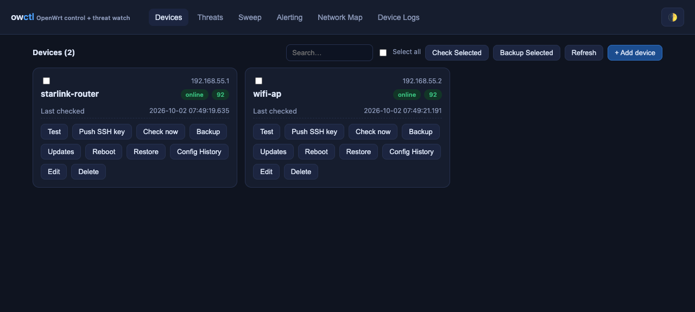

<!--
  Copyright (C) 2026 spidertje

  This program is free software; you can redistribute it and/or
  modify it under the terms of the GNU General Public License
  version 2 as published by the Free Software Foundation.

  This program is distributed in the hope that it will be useful,
  but WITHOUT ANY WARRANTY; without even the implied warranty of
  MERCHANTABILITY or FITNESS FOR A PARTICULAR PURPOSE.  See the
  GNU General Public License for more details.

  You should have received a copy of the GNU General Public License
  along with this program; if not, write to the Free Software
  Foundation, Inc., 51 Franklin Street, Fifth Floor, Boston, MA  02110-1301, USA.
-->
# owctl — OpenWrt fleet control + threat watch

Single-file backend (FastAPI) + zero-dependency dashboard. Manages multiple
OpenWrt boxes over **SSH** (primary) or the **LuCI API** (fallback), with
config-hygiene threat auditing, package upgrades, config backups, LAN sweep,
and configurable alerting.



## Run

```bash
cd owctl
python3 -m venv .venv && . .venv/bin/activate
pip install -r requirements.txt
python owctl.py                 # http://<this-host>:8090
```

Useful env:
- `OWCTL_HOST` (default 0.0.0.0), `OWCTL_PORT` (default 8090)
- `OWCTL_DATA` (data dir, default ./data)
- `OWCTL_LOG` (log file, default `<data dir>/owctl.log` — rotating, 5 MB x 4)
- `OWCTL_TRUST_PROXY` — set `1` only when owctl sits behind a trusted reverse
  proxy. Then the rate limiter keys on the rightmost `X-Forwarded-For` hop
  instead of the (proxy's) TCP address. Leave unset to rate-limit by real IP.
- `OWCTL_SSL_CERT` / `OWCTL_SSL_KEY` — serve over HTTPS (both must be set).
- `OWCTL_RATELIMIT_MAX` / `OWCTL_RATELIMIT_WINDOW` — API rate limit
  (default 120 req / 60 s per client IP).
- `OWCTL_ALLOW_OPEN` — set `1` to disable auth (dev/tests only).

## Security model

- **Auth is always enforced** on `/api/*` via **password login only**
  (`POST /api/auth/login`) → a 24h session token sent as
  `Authorization: Bearer *** On first boot the dashboard shows a
  **setup screen** (no username): choose an admin password and confirm it —
  submitted to `POST /api/auth/setup`, which seeds the `admin` account and
  returns a session. `GET /api/auth/status` reports `needs_setup` so the UI
  picks the right screen. After setup, the normal username/password sign-in
  applies. Two roles: `admin` (everything) and `observer` (read-only). There is
  no bearer-token back-door.
- **Device credentials are redacted**: `GET /api/devices` returns
  `has_ssh_password` / `has_luci_pass` booleans, never the raw passwords.
- **Rate limiting** (429 + `Retry-After`) protects the token endpoint from brute force.
- **Audit log**: mutating requests (POST/PUT/DELETE/PATCH) are recorded —
  method, path, client IP, timestamp, status — readable at `GET /api/audit/api`.
- **Hardening headers** on every response: `X-Content-Type-Options: nosniff`,
  `X-Frame-Options: DENY`, `Referrer-Policy: same-origin`.
- **TLS** is optional via `OWCTL_SSL_CERT` / `OWCTL_SSL_KEY`; otherwise serve
  behind a TLS-terminating reverse proxy (Caddy/nginx).

## Add devices

- **Manual**: Devices tab → + Add device (name, IPv4, role, access mode).
- **Sweep**: Sweep tab → enter `192.168.1.0/24` or `192.168.1.1-192.168.1.250`;
  live hosts come back with port hints; OpenWrt/LuCI boxes are flagged, one-click add.

Access modes:
- `ssh` — root key or password; most features (upgrades, backups, reboot, full audit).
- `luci` — LuCI web password; status + LuCI config backup + sysupgrade detection.

## QoS / SQM

QoS tab (SSH devices only): read live SQM (`luci-app-sqm`) or `nft-qos` config,
then apply `{enabled, interface, download_kbps, upload_kbps, qdisc (fq_codel|cake), ecn}`
with optional package auto-install. Applies idempotently via a named `wan` uci
section, then `uci commit sqm && sqm restart`.

## Firewall

Firewall tab (SSH devices only): port forwards, inter-zone rules and per-zone
default policies (input/forward). Reads live `uci show firewall`; applies via
named uci sections (idempotent re-apply + delete-by-name), then
`uci commit firewall && fw4 restart`. Saved state is tracked per device for
diffing against the live box.

## Threat engine

Checks per device: telnet enabled, SSH password auth, firewall default
INPUT/FORWARD=ACCEPT, NTP disabled, clock drift, outdated packages, firmware
(sysupgrade) updates, WAN down, port forwards, QoS (SQM) not enabled.
New findings fire alerts once, re-alert if they disappear and return.
Scheduler re-audits every 30 min (configurable in code via `audit_interval_min`).

## Alerting

Dashboard (always on), plus optional: Email (SMTP), Telegram (bot token +
chat_id), and a JSON Webhook. Minimum-severity threshold configurable.

## Testing

A self-contained end-to-end harness (`test_e2e.py`) stands up an in-process
paramiko SSH server (password + SFTP) and an HTTP server emulating LuCI, then
drives the real code paths (gather over both backends, threat audit, push-key,
backup, large-output exec, error messaging). No real router or network needed:

```bash
.venv/bin/python test_e2e.py     # 33 checks; exits non-zero on any failure
```

## Notes on the LuCI backend

- The LuCI RPC endpoint is **`/rpc`** (not `/cgi-bin/luci/rpc`, which 404s).
- Scheme (http/https) is auto-detected by probing ports 443 then 80; override
  with an explicit `luci_port` if LuCI runs elsewhere.
- LuCI access is read-mostly: status, sysupgrade detection, `opkg` list,
  config backup. Upgrades/reboot/SSH-key-push require the `ssh` backend.

## Files

- `owctl.py` — backend (API + scheduler)
- `static/index.html` — dashboard
- `test_e2e.py` — in-process mock-device test harness
- `data/` — sqlite DB, config backups, created at runtime

## Install via Hermes Agent

A Hermes Agent (this TUI or any profile with a terminal) can set this up on a
LAN machine in one pass. Give it the repo and it will run:

```bash
# on the LAN machine
git clone https://github.com/spidertje/owctl.git
cd owctl
python3 -m venv .venv
.venv/bin/pip install -r requirements.txt
.venv/bin/python owctl.py            # dashboard on http://<host>:8090
```

Hermes-friendly run modes (terminal tool):
- Foreground while working: `terminal(command="cd owctl && .venv/bin/python owctl.py", background=true)` — the agent then opens `http://<host>:8090` via the browser tool, adds devices, pushes SSH keys, and configures alerting through the UI or the JSON API.
- Persistent daemon: see **ROBUSTNESS.md** — `./launch.sh` (any OS, auto-restart on crash), `com.spidertje.owctl.plist` (macOS launchd), or `owctl.service` (Linux systemd). The app also logs to `<data dir>/owctl.log` (rotating), serves `GET /api/health` for liveness, auto-backs up the DB each cycle, and exits with a human-readable reason (exit code 2/3/4) on a bad start instead of a bare traceback.

Agent workflow after boot:
1. `POST /api/devices` per box (or `POST /api/sweep` with a `spec` like `192.168.1.0/24`).
2. `POST /api/devices/{id}/test` to verify credentials surface immediately.
3. `POST /api/devices/{id}/push-key` so subsequent access is key-only.
4. `POST /api/devices/{id}/check` to run the threat audit; review `GET /api/findings`.
5. `PUT /api/alerts/config` to enable Email / Telegram / Webhook channels.
6. Auth is password-login only: `POST /api/auth/login` sets the admin password
   on first boot and returns a 24h session token; send it as
   `Authorization: Bearer *** on subsequent `/api/*` calls.
